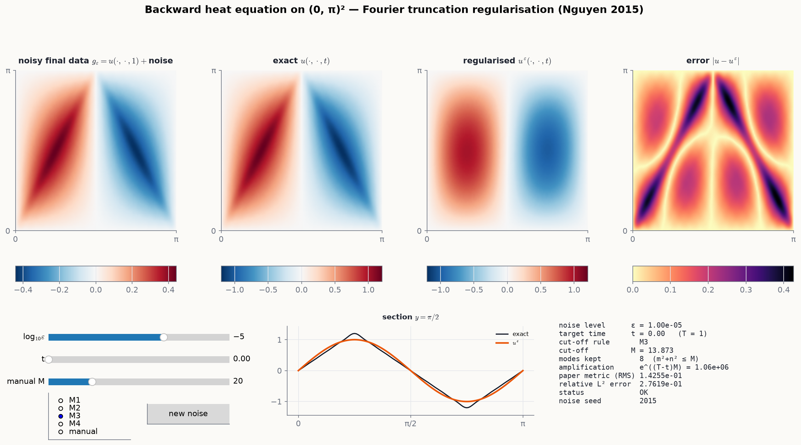

# Backward Heat Equation in 2-D: Fourier Truncation Regularisation

A faithful Python reproduction of

> **H. T. Nguyen**, *Stability and regularization for 2-D backward heat conduction equation*,
> **Mathematical Reports 17(67)**, no. 1 (2015), 1–23. (`paper.pdf`)



## What the project does

Given the temperature `g = u(·,·,T)` at the final time, recover the earlier state `u(·,·,t)` (in particular `t = 0`) of

```
u_t − (u_xx + u_yy) = f   in (0,π)² × (0,T),      u = 0 on the boundary,      u(·,·,T) = g.
```

The problem is **ill-posed**. The sine mode `(m,n)` must be multiplied by `e^{(T−t)(m²+n²)}`, so any measurement noise explodes.
The paper's remedy is **Fourier truncation**: keep only the modes with `m² + n² ≤ M_ε`, where the cut-off `M_ε` grows slowly as the
noise level ε → 0.

```
u^ε(x,y,t) = Σ_{m²+n² ≤ M_ε} [ e^{(T−t)(m²+n²)} (g_ε)_mn − ∫_t^T e^{(s−t)(m²+n²)} (f_ε)_mn(s) ds ] sin(mx) sin(ny)      (12)
```

## Results at a glance

| Published item | Status |
|---|---|
| **Table 1** — cut-offs M¹–M⁴ for ε = 10⁻³, 10⁻⁵, 10⁻⁷ | ✅ all 12 values reproduced to every printed digit |
| **Table 2** — errors for t = 0 … 0.9 | ✅ 119/120 entries within 0.42% (median 5·10⁻⁵); 1 typo in the paper |
| **Figure 1** — 3-D surfaces | ✅ qualitative match |
| **Figure 2** — section cuts | ✅ qualitative match |

Recovered from the paper's own numbers (not stated in the text): `r = 2` in Theorem 6, the square-root form of `M⁴`, and the
error metric (RMS over the 129² grid nodes). Ambiguities and errata are documented in
[`docs/paper_analysis.md`](docs/paper_analysis.md).

## Quick start

```bash
python -m venv .venv
# Windows (PowerShell):  .venv\Scripts\Activate.ps1      Windows (cmd): .venv\Scripts\activate.bat
# macOS / Linux:         source .venv/bin/activate
pip install -r requirements.txt

pytest -v                              # 64 mathematical tests (~10 s)
python experiments/run_all.py          # all experiments, figures and tables (~2 min)
python demo.py                         # interactive live demo with sliders
```

Optional: `pip install -e .` installs the package `backward_heat`. The scripts also run without it.

## Presenting it (suggested 10-minute flow)

1. **The problem.** Open `results/figures/exp01_forward_evolution.png`: diffusion smooths the solution as time runs forward.
2. **Why it is hard.** Show `exp02_noiseless_reconstruction.png`: *without any noise*, keeping modes up to `M = 80` turns
   float64 rounding (10⁻¹⁶) into an error of size 10¹⁷.
3. **The method, live.** Run `python demo.py`. Pick rule M³ and move ε; then switch to "manual" and push `M` beyond 25.
4. **Reproduction.** Show `table2_reproduction.png` (crosses = paper, lines = this code), `figure1_surfaces.png`
   and `figure2_section_cuts.png`.
5. **Beyond the paper.** Show `exp04_tradeoff.png`, which illustrates the stability–accuracy trade-off and why "bigger M" is
   only better up to a point.

The notebook [`notebooks/analysis.ipynb`](notebooks/analysis.ipynb) follows the same story with code. It is pre-executed;
rebuild it with `python notebooks/build_notebook.py`.

## Running individual experiments

| Script | Content | Paper? |
|---|---|---|
| `experiments/experiment_01_forward_validation.py` | spectral forward solve vs analytical `g`; Crank–Nicolson and quadrature convergence | verification |
| `experiments/experiment_02_noiseless_reconstruction.py` | ε = 0: truncation error vs amplified rounding | supplementary |
| `experiments/experiment_03_noise_sensitivity.py` | noisy data at the paper's ε; error vs ε over 10⁻¹…10⁻¹⁴; Fourier picture | partly supplementary |
| `experiments/experiment_04_regularization_parameter.py` | error vs M: truncation/noise decomposition, three regimes | supplementary |
| `experiments/experiment_05_reproduce_paper.py` | **Tables 1–2, Figures 1–2**, seed-sensitivity study | **reproduction** |
| `experiments/run_all.py` | all of the above, plus a summary | |

Outputs:

```
results/figures/   PNG (220 dpi) + PDF for every figure
results/tables/    CSV (full precision) + Markdown for every table
results/raw/       JSON / CSV raw numbers and the configuration used for each run
results/logs/      one log file per experiment
```

## Project layout

```
backward-heat-reproduction/
├── paper.pdf                      the reproduced paper
├── demo.py                        interactive demo (matplotlib widgets)
├── docs/
│   ├── paper_analysis.md          extraction of the paper, ambiguities A1–A13
│   ├── mathematical_derivation.md derivations: ill-posedness, eq. (12), Table 2 closed form
│   ├── implementation_notes.md    code ↔ equation map, design choices
│   └── reproduction_report.md     full report with figures and comparison
├── src/backward_heat/
│   ├── config.py                  all parameters and published values
│   ├── fourier.py                 grid, eigenvalues, DST-I (4/π² normalisation), truncation
│   ├── analytical.py              exact benchmark (24)
│   ├── source.py                  Duhamel integrals (closed form / quadrature)
│   ├── forward_solver.py          spectral forward solver; Crank–Nicolson cross-check
│   ├── noise.py                   g_ε = g + (ε/π)·rand()
│   ├── regularization.py          cut-off rules M¹–M⁴, eq. (12), a-priori bounds
│   ├── reconstruction.py          end-to-end pipeline
│   ├── metrics.py                 paper metric, L², relative, MSE, RMSE, max
│   └── visualization.py           figure style and plotting helpers
├── experiments/                   one script per experiment + run_all.py
├── notebooks/analysis.ipynb       guided walkthrough
├── tests/                         pytest suite
└── results/                       generated output
```

## Using the library

```python
from backward_heat import Grid, PaperExample, SeparableExponentialSource, add_paper_noise, make_rng, reconstruct
from backward_heat.regularization import cutoff_rules

grid, ex = Grid(128), PaperExample()
src = SeparableExponentialSource(ex.f_spatial_coefficients(grid))
g_eps = add_paper_noise(ex.g_grid(grid), grid, 1e-5, make_rng(2015)).values
M = cutoff_rules()["M1"](1e-5, 1.0)                     # 8.986
res = reconstruct(g_eps, t=0.0, cutoff=M, grid=grid, final_time=1.0, source=src)
res.u, res.n_modes, res.amplification                   # field, 4 modes, e^{TM}
```

## Tests

`pytest -v` checks mathematical correctness, not merely that the code runs:

* the PDE, boundary and final conditions of the benchmark (symbolically with SymPy, and numerically);
* sine-transform normalisation against `scipy.integrate.dblquad`, round trips and Parseval;
* exact forward evolution, the semigroup property, and second-order convergence of Crank–Nicolson and of the Filon quadrature;
* all 12 Table 1 values, the closed-form noise-free Table 2 values, and every Table 2 entry with the paper's noise model (≤ 1%);
* Theorem 3's stability estimate, the exact `e^{(T−t)λ}` amplification, and that overflow raises an error instead of returning inf/NaN;
* the noise bound `‖g_ε − g‖ ≤ ε`, reproducibility under a fixed seed, and that zero noise is exact.

## Requirements

Python ≥ 3.11 (developed on 3.14) · NumPy · SciPy · Matplotlib · pandas · SymPy · pytest · nbformat/nbconvert/ipykernel
(notebook only). Runs on a standard laptop; no GPU.
