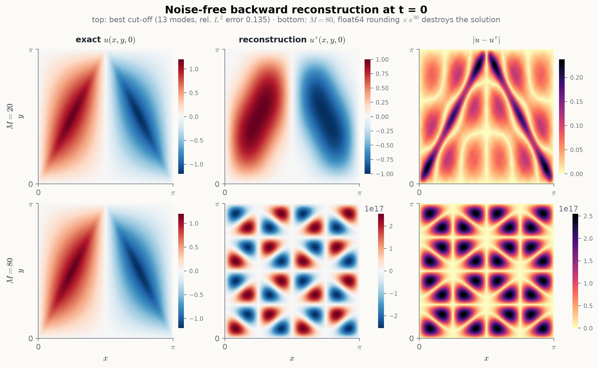
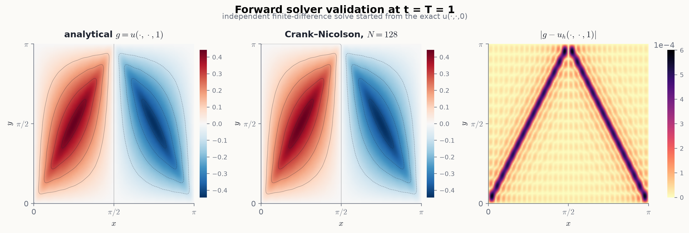
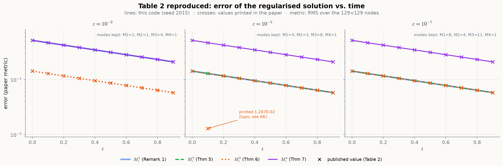
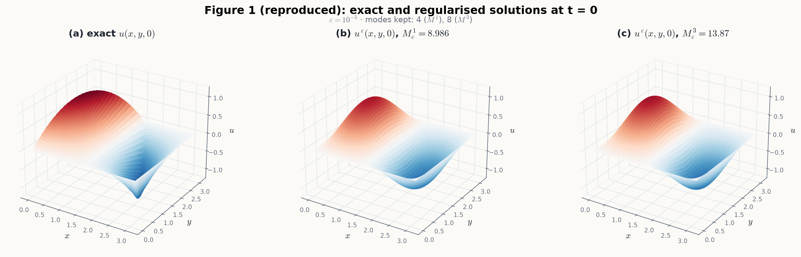
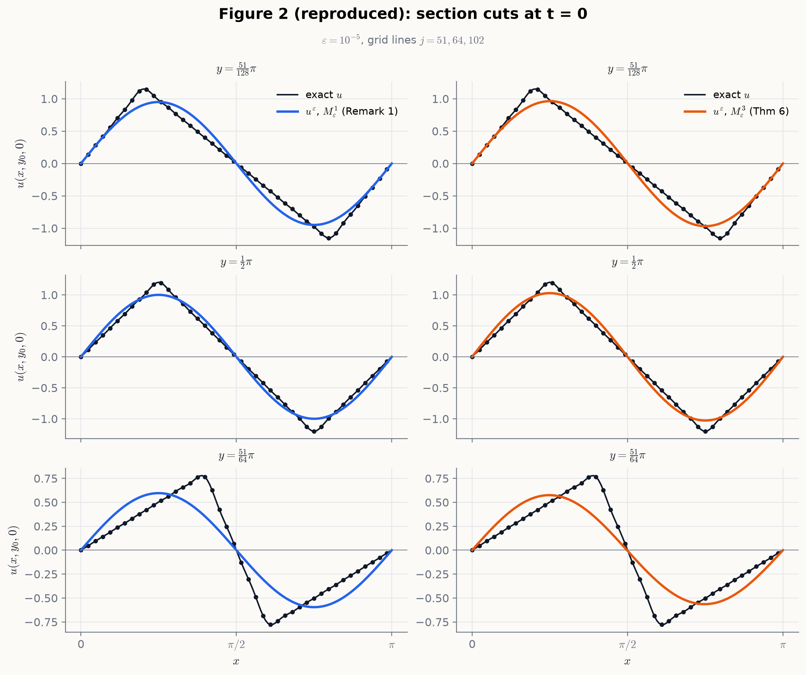
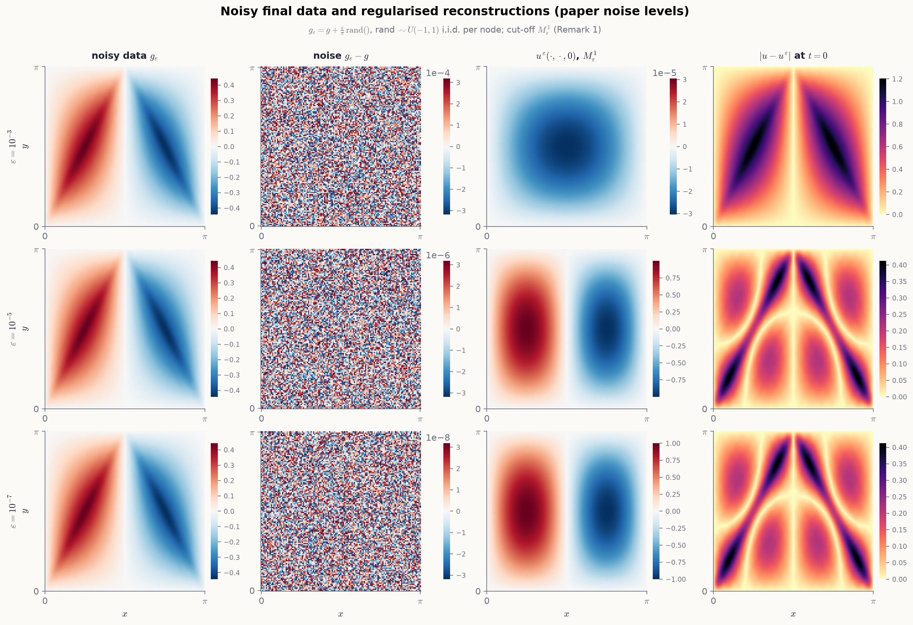
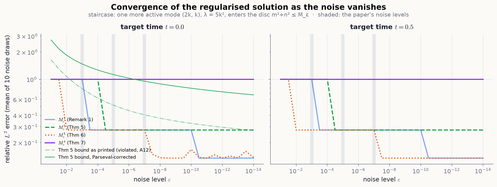
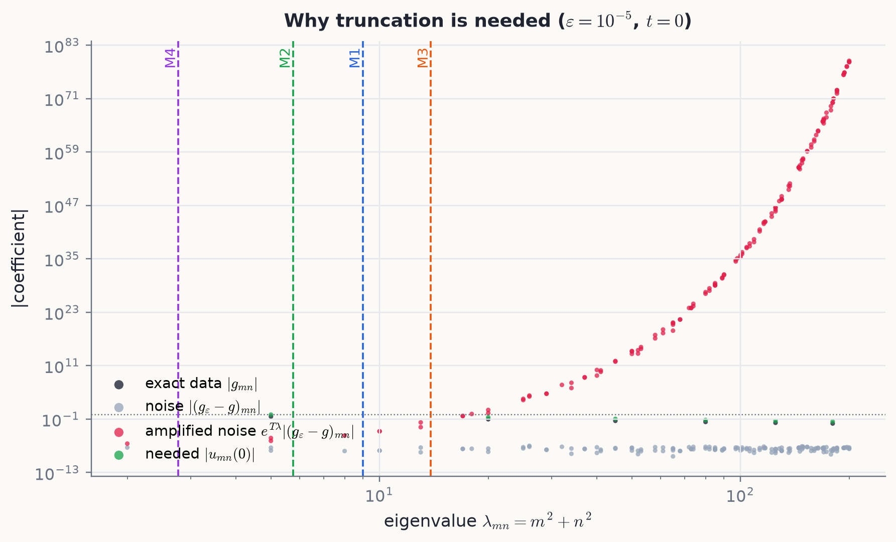
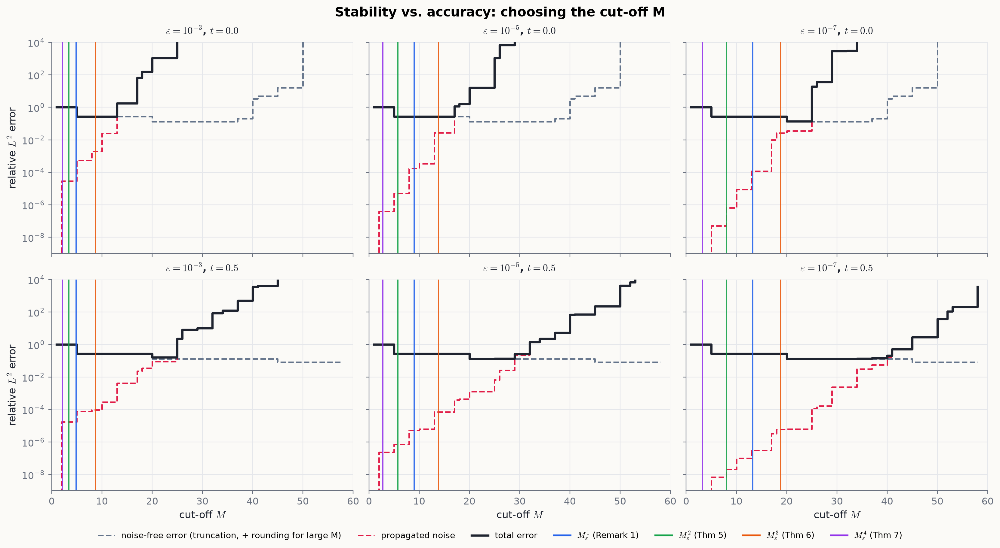
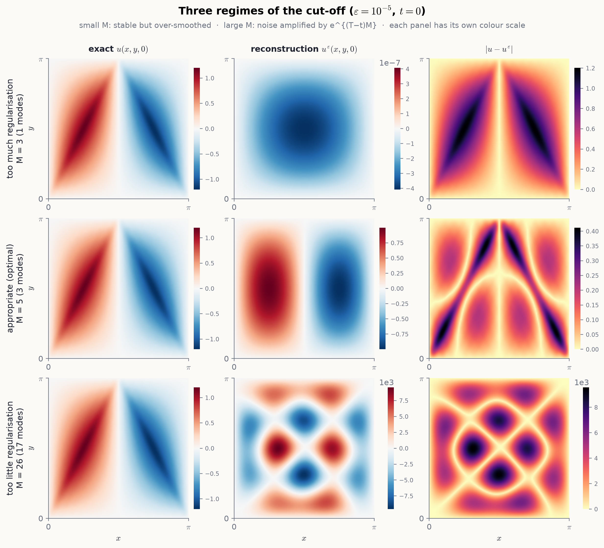

# Reproduction Report

**Paper:** H. T. Nguyen, *Stability and regularization for 2-D backward heat conduction equation*,
Mathematical Reports 17(67), no. 1 (2015), pp. 1–23.

**Bottom line.** The Fourier truncation method of the paper was implemented as published.
* **Table 1** (12 cut-off values) is reproduced to every printed digit.
* **Table 2** (120 error values) is reproduced with a median relative difference of 5·10⁻⁵ and a maximum of 0.42%.
  The remaining differences are explained by the noise realisation and the paper's 4-digit rounding.
  One printed entry is a typo.
* **Figures 1 and 2** are reproduced qualitatively.

Three details are not stated in the paper and were recovered from its own numbers: the parameter `r = 2`, the form of `M⁴`, and the error metric.
The report also documents several inconsistencies in the paper's statements, and adds supplementary
experiments that test the paper's conclusion "the bigger the value M_ε, the better".

---

## 1. Introduction

Recovering an earlier temperature distribution from a measurement at a later time is a classic inverse
problem. Diffusion smooths out fine detail at a rate that grows exponentially with spatial frequency. Undoing it
amplifies measurement noise by the same exponential factor. Nguyen's paper proposes to
*discard* every Fourier mode above a cut-off `M_ε`. It proves stability and convergence estimates and
demonstrates the method on a 2-D benchmark. This project re-implements the method from scratch in Python and reproduces
the benchmark.

## 2. Research problem

Determine `u(·,·,0)` from

```
u_t − (u_xx + u_yy) = f(x, y, t)   in (0,π)² × (0,T),
u = 0                              on ∂Ω,
u(x, y, T) = g(x, y),
```

where `f` and `g` are known only up to `‖f_ε − f‖ ≤ ε` and `‖g_ε − g‖ ≤ ε`.

## 3. Mathematical formulation

With `λ_mn = m² + n²` and coefficients `h_mn = (4/π²)⟨h, sin(mx)sin(ny)⟩`, the exact solution is (eq. 6)

```
u_mn(t) = e^{(T−t)λ_mn} g_mn − ∫_t^T e^{(s−t)λ_mn} f_mn(s) ds.
```

A full derivation is in [`mathematical_derivation.md`](mathematical_derivation.md).

## 4. Ill-posedness

A data error in mode `(m,n)` is amplified by `e^{(T−t)(m²+n²)}`: a factor `e^{20} ≈ 5·10⁸` for mode `(4,2)` at `t = 0`,
and `e^{80} ≈ 5·10³⁴` for mode `(8,4)`. Experiment 2 shows that even **float64 rounding** (relative size 10⁻¹⁶) destroys the
reconstruction once `M ≳ 40` at `t = 0`.



## 5. Regularisation method

Fourier truncation (eq. 12): `u^ε_mn(t) = 1{λ_mn ≤ M_ε} [e^{(T−t)λ_mn}(g_ε)_mn − ∫_t^T e^{(s−t)λ_mn}(f_ε)_mn ds]`.
Theorem 3 bounds the amplification by `e^{(T−t)M_ε}`, which is verified numerically in the tests.
The four cut-off rules compared in the paper are:

| Rule | Formula |
|---|---|
| M¹ (Remark 1) | `(1/T) ln(T / (ε + ε ln(T/ε)))` |
| M² (Theorem 5) | `ln(1/ε)/(2T)` |
| M³ (Theorem 6) | `(1/T) ln(T (ln(T/ε))^r / (ε + ε ln(T/ε)))`, **r = 2 (inferred)** |
| M⁴ (Theorem 7) | `sqrt(ln(1/ε)/(T+β))`, β = 1/2 |

## 6. Numerical implementation

* Grid: 129 × 129 nodes `x_i = iπ/128`, as in the paper.
* Sine coefficients: DST-I, which equals the trapezoidal rule and is exact for every representable mode.
* Source term: closed-form Duhamel integral for the separable `f`. A general grid-based path is cross-validated.
* Noise: `g_ε = g + (ε/π)·U(−1,1)`, iid per node, seed 2015. The actual `‖g_ε−g‖_{L²} ≈ 0.58ε ≤ ε`.
* Code ↔ equation mapping and design choices: [`implementation_notes.md`](implementation_notes.md).

## 7. Experimental setup

| Parameter | Value | Source |
|---|---|---|
| `T` | 1 | paper |
| grid | `(I,J) = (128,128)` | paper |
| ε | 10⁻³, 10⁻⁵, 10⁻⁷ | paper |
| t | 0, 0.1, …, 0.9 | paper |
| β | 1/2 | paper |
| r | 2 | **inferred** from Table 1 (fits: 1.9999, 1.9987, 2.0008) |
| metric | RMS over the 129² nodes | **inferred** from Table 2 |
| RNG | iid U(−1,1), seed 2015 | implementation choice |

| Experiment | Status |
|---|---|
| 1 Forward validation | supplementary verification |
| 2 Noise-free reconstruction | supplementary |
| 3 Noise sensitivity | paper noise levels plus a supplementary ε sweep |
| 4 Regularisation parameter | supplementary |
| **5 Tables 1–2, Figures 1–2** | **reproduction** |

## 8. Results

### 8.1 Forward validation (Experiment 1)

| Solver | relative L² error at t = 1 |
|---|---|
| spectral, eq. (11) | 4.1 · 10⁻¹⁶ |
| Crank–Nicolson, N = 32 / 64 / 128 | 1.2·10⁻² / 2.7·10⁻³ / 6.6·10⁻⁴ (observed order 2.15, 2.03) |
| Filon source quadrature, 25 → 400 panels | observed order 2.000 |

The final data `g` given in the paper is consistent with the forward problem.



### 8.2 Table 1: reproduced exactly

| | ε = 10⁻³ | ε = 10⁻⁵ | ε = 10⁻⁷ |
|---|---|---|---|
| M¹ | 4.840 ✔ | 8.986 ✔ | 13.28 ✔ |
| M² | 3.454 ✔ | 5.756 ✔ | 8.059 ✔ |
| M³ | 8.705 ✔ | 13.87 ✔ | 18.84 ✔ |
| M⁴ | 2.146 ✔ | 2.770 ✔ | 3.278 ✔ |

The largest relative deviation from the printed (rounded) values is 2.2·10⁻⁴. All 12 values are regression-tested.

### 8.3 Table 2: reproduced

Selected rows (ours / paper). Full table: `results/tables/table2_side_by_side.md`.

| t | ε=10⁻³ M¹ | ε=10⁻³ M³ | ε=10⁻⁵ M¹ | ε=10⁻⁵ M³ | ε=10⁻⁷ M³ | any ε, M⁴ |
|---|---|---|---|---|---|---|
| 0.0 | 0.51612 / 0.5161 | 0.14227 / 0.1423 | 0.14227 / 0.1423 | 0.14300 / 0.1424 | 0.14291 / 0.1424 | 0.51612 / 0.5161 |
| 0.5 | 0.31304 / 0.3130 | 0.086292 / 0.08629 | 0.086292 / 0.08629 | 0.086292 / 0.08629 | 0.086292 / 0.08629 | 0.31304 / 0.3130 |
| 0.9 | 0.20984 / 0.2098 | 0.057843 / 0.05784 | 0.057843 / 0.05784 | 0.057843 / 0.05784 | 0.057843 / 0.05784 | 0.20984 / 0.2098 |

* 119 comparable entries: median |relative difference| **5.2·10⁻⁵**, maximum **4.2·10⁻³**.
* The maximum occurs at `M³`, ε = 10⁻⁵ and 10⁻⁷, t = 0. These are the only settings where the amplified noise is visible:
  8 or 11 modes are kept, with amplification up to 1.5·10⁸. Over 50 independent noise realisations
  the error ranges over [0.14227, 0.14337] (ε=10⁻⁵) and [0.14230, 0.14346] (ε=10⁻⁷). The paper's 0.1424 lies inside both ranges.
* Typo: at ε = 10⁻⁵, `M³`, t = 0.1 the paper prints 1.287E-02. We obtain 1.2879E-01, the value the paper prints in all neighbouring cells.



### 8.4 Figures 1 and 2: reproduced qualitatively

Both regularised solutions reduce to the smooth dominant mode `e^{−t} sin(2x) sin(y)`, plus negligible noise. The
kinks of the exact solution (sharp ridges caused by the slowly decaying `k⁻²` series) are lost. This matches the published
figures. In Figure 2 at `y = 51π/64` the reconstruction is a sine arch while the exact profile has a steep jump, as in the paper.




### 8.5 Noise sensitivity (Experiment 3, ε sweep supplementary)



Over ε = 10⁻¹ … 10⁻¹⁴ the error falls in **steps**. Each step occurs when another active mode `(2k,k)` with `λ = 5k²`
enters the disc `m² + n² ≤ M_ε`. Between steps the error is flat, because it is dominated by truncation. For M¹ and M² this is *consistent with* the
convergence `u^ε → u` of Remark 1 / Theorem 5, but it is slow: to keep `k = 2` at `t = 0`, `M¹` needs ε ≲ 10⁻¹⁰.
M⁴ never keeps a single mode in the whole sweep (it would need ε ≈ 5·10⁻¹⁷), so its error stays at 100%. The M³ curve
wobbles once it keeps `k = 2`, because the printed M³ does not drive the propagated noise to zero (A13).

**Theorem 5's printed bound is violated** at the paper's own noise levels. At ε = 10⁻³ the bound is 1.28, but the true
L² error is 1.634 (M² = 3.45 keeps no signal mode). This is erratum A12. The Parseval-corrected bound
`√ε + √(2T)‖u(0)‖_{H¹₀}/√ln(1/ε)` (= 2.41 at ε = 10⁻³) holds everywhere. Both bounds are plotted and tested.




### 8.6 Regularisation parameter (Experiment 4, supplementary)

The paper concludes "the bigger the value M_ε, the better". That holds only inside the range of Table 1 (M < 20).
Splitting the error into truncation and propagated noise shows the trade-off:

| ε, t | best M (sweep) | best error | M¹ error | M³ error |
|---|---|---|---|---|
| 10⁻³, 0 | 5 | 0.276 | 1.000 | 0.276 |
| 10⁻⁵, 0 | 5 | 0.276 | 0.276 | 0.277 |
| 10⁻⁷, 0 | 20 | 0.139 | 0.276 | 0.277 |
| 10⁻⁵, 0.5 | 20 | 0.135 | 0.276 | 0.276 |

(relative L² errors)

At ε = 10⁻⁵, t = 0: `M = 3` gives relative error 1.00 (over-regularised: nothing is kept); `M = 5` gives 0.276; `M = 26` gives
6.8·10³ (noise amplified by `e^{26}`). The a-priori rules are safe but conservative. For ε = 10⁻⁷, or for t > 0, an
a-posteriori choice of `M` would halve the error.




## 9. Comparison with the published results

| Item | Verdict |
|---|---|
| Table 1 | **exact match** (all 12 values) |
| Table 2 | **match** to ≤ 0.42% (119/120 entries); 1 typo in the paper |
| Figure 1 | qualitative match (same smooth single-mode reconstructions, same colour range) |
| Figure 2 | qualitative match (same cut lines, same shapes) |
| Paper's claim "bigger M better" | true only for M < 20; supplementary Experiment 4 |

## 10. Error analysis

* **Truncation error dominates Table 2.** All published `M_ε < 20`, so at most the mode `k = 1` is recovered. The error is
  `(64/129) e^{−t} (Σ_{k>k₀} k⁻⁴)^{1/2}` to 4 digits. Noise contributes only in the 4th digit for `M³`.
* **Metric.** The table's "L²" values are RMS values over the grid nodes. The true `L²(Ω)` errors are larger by a factor
  `π·129/128 ≈ 3.17` (both are saved in `table2_long.csv`).
* **Inconsistencies in the paper** (details in [`paper_analysis.md`](paper_analysis.md)):
  * eq. (3) integrates over the wrong interval (A4);
  * `M⁴` appears with a square root in the statement but without it in the proof (A2);
  * `r` is unspecified (A1);
  * Theorem 4's constants are too small; the printed bound fails at M = 3, and Theorem 5's printed bound fails at
    ε = 10⁻³ and 10⁻⁴ (A12);
  * in Theorem 6, the printed `M³` makes the noise factor grow like `ln(1/ε)` at `t = 0`, contrary to the stated estimate (A13);
  * Table 2 has a typo (A6).

  None of these affects the method itself.

## 11. Limitations

* The noise realisation of the paper is unknown, so agreement in the noise-sensitive cells is statistical.
  With 50 seeds the paper's values fall inside our range.
* Figures 1–2 are compared visually only (no data were published).
* The benchmark tests a single, rather special solution: a finite series on the diagonal modes `(2k,k)`. With the paper's ε
  only one mode is ever recovered.
* Noise in `f` is supported by the code (Theorem 3 covers it) but is not exercised, because the paper does not use it.

## 12. Conclusion

The truncation method is easy to implement, provably stable and cheap: one reconstruction takes about 1 ms on a 129² grid. All
quantitative results of the paper were reproduced, once three unstated details (r, the M⁴ form, the metric) were
recovered from the paper's own tables. The supplementary experiments show what the paper does not discuss. The exponential
amplification limits the attainable resolution severely: at `t = 0` only modes with `λ ≲ ln(1/ε)` can be recovered.
The a-priori rules M¹–M³ are reliable but conservative, while M⁴ (Theorem 7, β = ½) is far too conservative for this example.

## 13. References

1. H. T. Nguyen, *Stability and regularization for 2-D backward heat conduction equation*, Math. Reports 17(67), 1 (2015), 1–23.
2. L. C. Evans, *Partial Differential Equations*, AMS, 1998 (Ch. 6.5, eigenvalues of the Laplacian).
3. P. T. Nam, D. D. Trong, N. H. Tuan, *The truncation method for a two-dimensional nonhomogeneous backward heat problem*, Appl. Math. Comput. 216 (2010) 3423–3432.
4. C.-L. Fu, X.-T. Xiong, Z. Qian, *Fourier regularization for a backward heat equation*, J. Math. Anal. Appl. 331 (2007) 472–480.
